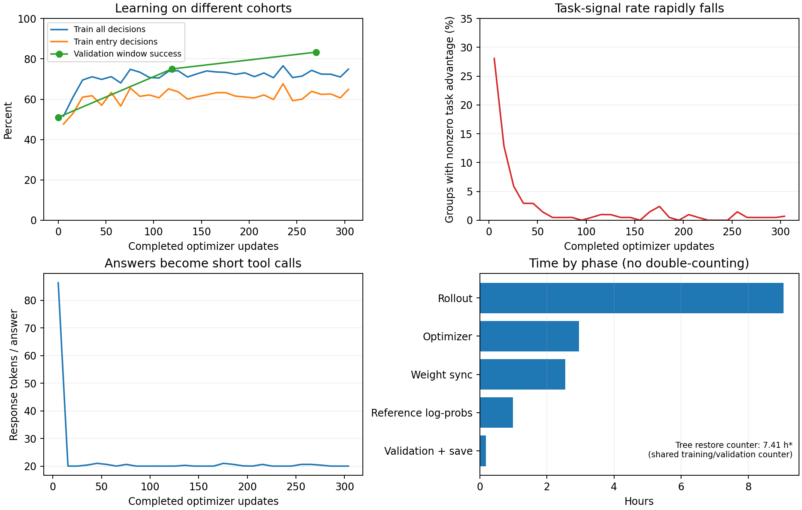

# Job 960070 本地日志复核（2026-10-17）

结论：训练已在真实单 H100 上跑通，验证提案决策有改善；但同节点采样多样性很快降低，
后期大量持续错误题没有 task advantage，调查题没有学会。运行时间主要花在游戏树恢复和
每批固定的 GPU 工作上。暂不建议按原配置直接把预算续到 6M；本次只核查，不修改训练代码或协议。

后续专项排查见[题面、工具与prompt](prompt_interface/README.md)：376种实际上下文的
原生动作映射/评分身份核对；解释指令位置、未说明的0/1完整目标向量、参考策略与先验说明缺口；
保留9月及当前解码后的实际prompt和同题人工展开，未改正式训练代码。

## 证据范围

- 原始包 SHA-256：`29b6afabd9d68ae91d3a9f5deba267d3b2ba17f47344a59a8c465f341b47f04a`。
  `verify_logs.py` 校验了 956 个文件及压缩包原始字节。
- 全量核查 307 个已完成更新、6,279 个节点组、50,232 个回答；第 308 次 collection
  （step 307）已有 calls/units/games，但未完成 optimizer，不计入上述统计。
- 全量重算日志内 Q 对应的连续 reward、严格正确标签、组内 sample-std advantage、
  protocol advantage；检查组内相同 prompt tokens/Q/posterior/scoring identity、8 个独立
  request seed、单个选中样本、unit/metric 汇总及 root Q 与冻结题库一致。未发现不一致。
- 远端 `source_manifest.json` 中 784 个源文件与本地版本全部一致。
- 另抽查双人/三人 × k=1/2/3 六条真实推进链，使用原生环境重放、重建可见 posterior，
  后续节点使用原有穷举 `extreme_value` 独立核对 Q；均通过，合计 12 个受控决策。
  这是抽样复核，不是把所有后续节点重新穷举一次。
- 没有修改原始日志，没有调用模型，没有重新训练，没有运行 test。

## 实际训练进展与验证

单 H100-96、Qwen3-4B-Instruct-2507 从 base 开始；实际配置与已定协议一致：
G=8、并发32、目标20节点组/update、continuous negative regret、同节点归一化、
均匀预选一条推进、每批一次 optimizer、6M response-token 预算。

用户取消前占用 15:49:44，完成 307 updates / 1,123,499 tokens，约为预算的18.7%。
未完成正式实验，没有 final test。末次采样后停在 `reference_log_probs` 阶段。

| 已完成 updates | 训练 tokens | 验证整段成功 | 全决策严格正确 | 入口严格正确 | 平均 regret（失败按最差） |
| ---: | ---: | ---: | ---: | ---: | ---: |
| 0 | 0 | 49/96 = 51.04% | 67.53% | 64.58% | 0.19520 |
| 119 | 500,665 | 72/96 = 75.00% | 82.99% | 79.17% | 0.08249 |
| 270 | 1,001,172 | 80/96 = 83.33% | 88.36% | 84.38% | 0.04725 |

改善不是仅由修复格式带来：提案入口正确数为 **17/46 → 31/46 → 36/46**。
但响应入口一直 **45/50**，三个验证点都只选 ACCEPT，没有学会区分那5个不该接受的场景。
验证96题有24个入口 Q 全平，且没有 `information_positive` 题；不能把总正确率
当成主动调查能力。训练100题经过D筛选，验证为完整固定cohort，两者难度和分布不同，
不能仅按训练72%/验证88%判断过拟合。

完整游戏验证也已跑通：team completion 为66.7%→100%→100%，completed parent-macro
utility 为0.59375→1.81944→1.81944。后两个点完整team效用没有继续增加。
focal-vs-reference completion 为87.9%→100%→97.0%，最后一个点有1条非法回答；
completed utility 为1.25694→1.44213→1.42824，需结合失败 bounds 看，不能只比较已完成均值。
这里只各有12个parents、每设置1个repeat，不能据此下强泛化结论。

## 训练信号：主要问题是同节点采样趋同

| 更新序号（从1开始） | 有 task advantage 的组 | 组占比 | 每回答平均 tokens |
| --- | ---: | ---: | ---: |
| 1–10 | 57/203 | 28.08% | 86.35 |
| 11–50 | 50/814 | 6.14% | 20.35 |
| 51–100 | 6/1,028 | 0.58% | 20.24 |
| 101–150 | 7/1,018 | 0.69% | 20.05 |
| 151–200 | 9/1,025 | 0.88% | 20.34 |
| 201–250 | 3/1,022 | 0.29% | 20.13 |
| 251–307 | 8/1,169 | 0.68% | 20.28 |

全程仅140/6,279组有 task advantage。连续reward确实救回了42个二分后无差异的组，
但不能给8个相同动作创造差异。全程237次更新没有task信号，其中232次连protocol信号
也没有，仍执行了optimizer，loss只剩KL。Adam动量仍可能改变参数，不能把它们称为
“参数完全不变”；同理，on-policy组均值导致task loss数值接近0，也不能单凭loss判断没有梯度。

末57次更新中：

- 1,154/1,169组（98.72%）只采到一种合法动作，**实际没有任何节点的合法菜单只有一个动作**。
  原指标 `single_legal_action_groups` 统计的是“采样到一种合法动作”，不是“环境仅有一个合法动作”。
- 843组零信号且全对，318组零信号且全错，只有8组有task信号。
- 只有157组Oracle全平；采样无信号不能主要归因于Oracle把动作都判成一样。
- 训练全决策正确率72.65%，入口62.32%，后续节点91.42%；不能只看全决策平均。
- 100题中37题在这段时间的所有入口采样持续全错，59题持续全对，4题有变化。
  全程从未产生任何task信号的26题中，13题属于上述持续全错，13题持续全对。

例如 `1389ba1c89b26d0667b6de12`：REJECT/ACCEPT 的 Q 为 `[0, -0.939394]`，
8次都选择 ACCEPT，所以8个连续reward都是 `-0.939394`，组内 advantage 全0。
这里有真实的可改进动作，问题在于采样没覆盖它；改回二分也不会改善。

每道题实际入口曝光40–41次，即320–328个入口回答，含后续节点平均502个回答/题。
100道题每题的入口prompt及评分identity在全程都只有一种；hidden world reset没有
创造新的可见入口题面。这是冻结题定义下的预期行为，不能靠独立reset自动解决探索问题。

## 补充：brief reasoning 提示仍在，但解释没有被执行为协议要求

针对回答过短的追问，另全量检查了50,232个训练请求：全部system prompt都包含
`Give brief reasoning, then call act exactly once with the index of a listed legal action.`，
全部请求max_tokens仍为1024。没有因请求上限改成20而截短。

原生token ID解码所得raw text也只有工具调用，而不是parser把解释藏掉；典型20-token回答为：

```text
<tool_call>
{"name": "act", "arguments": {"action_index": 1}}
</tool_call><|im_end|>
```

前10次更新1,624个回答中已有1,476个恰好20 tokens，另有88个截断回答；因此均长86.35
不能理解为普遍存在约86-token的简短解释，少量长回答/截断明显抬高均值。
第51–307次更新42,096个回答中，42,079个恰好20 tokens（99.96%）。
按工具调用前是否有非空原始文字粗查，该后段有效回答42,078个中仅7个带调用前文字；
这只是存在性统计，不是解释正确性或质量评分。

原因在当前合同执行：`common.decode`只要求恰好一个act调用且action_index合法，
`terminal_training.score_response`只按动作Q给task reward；缺少解释没有被标记为
protocol failure。有解释和无解释但动作相同的合法回答获得相同task/protocol reward。
已有protocol惩罚会惩罚截断，但没有单独的长度奖励或“越短越好”reward；不能仅凭这些
日志把解释消失因果归结于某一项loss。最明确的遗漏是“提示要求解释，但没有落实为
可验证的输出协议，也没有持续记录解释存在率”。本次仍不自动增加解释监督或修改训练。

进一步核查最初10次更新：115个带调用前文字的回答中，88个截断、25个合法，
101个combined advantage为负，12个为正，其余为零；1,509个无调用前文字的回答全部合法。
在46个同时出现两种输出样式的节点组中，43组的带文字回答平均combined advantage更低。
由于同一回答的advantage施加于全部response tokens，截断失败会连同前面的解释文本一起
负向更新，而缺解释并不算失败。这是“直接工具调用被强化”的明确更新方向证据，
但样式与动作、难度、长度相互关联，不能视为已经用对照实验隔离出解释的独立因果效应。
变化也非常早：首批176个回答有44个带调用前文字，第二批49/160，第三批15/160，
第四批4/160，第五批3/168；第6–10批全部无调用前文字，且全部恰好20tokens。

### 与旧job 915731的提示词及解释历史比较

进一步校验旧训练归档全部1,727个文件后，直接对比实际请求，结果见
[prompt_history_comparison.json](prompt_history_comparison.json)。
两轮system prompt逐字一致；当前100道入口题的messages/tools及编码后prompt token IDs
均能在旧训练中找到完全相同的记录。`common.py`、`terminal_d.py`、Hermes解析入口
`social_b_grpo.py`源文件hash相同，基础模型/分词器文件hash也相同；生成temperature、
top_p、top_k及1024输出上限一致。后续访问到的节点随动作而变，不能把这称为全部后续请求相同。

旧训练也已经出现省略解释：26,094个训练回答中22,244个（85.25%）直接以工具调用开始。
旧第380次验证149个回答中147个仅工具调用，平均23.27tokens；第550次验证146个回答
全部仅工具调用且恰好20tokens。它不是新v6才出现的问题。旧版中期还出现长回答回升、
截断增多，然后重新缩短的波动；不能仅凭平均长度把它解读成稳定的brief explanation。

旧版与新版的reward、advantage分组、批次与采样路径确有改变。它们可能影响变化速度，
两次运行本身不足以隔离是哪项造成了差异。更早9月的B/P/SP链路另用自然语言观察和
具名动作工具，与当前terminal的JSON观察和act(action_index)不是相同prompt；
“没变”在这里严格限定为915731与960070两次terminal训练的同题输入。

### 用户明确比较9月B/P/SP后的复核

上述915731只是10月terminal历史，不能用来回答用户对9月训练的记忆。
直接检查9月保留的原始训练回答，结果见
[september_explanation_comparison.json](september_explanation_comparison.json)：

| 9月证据范围 | 回答数 | 带非空assistant content | 直接以tool call开始 |
| --- | ---: | ---: | ---: |
| 9月21日归档旧BP，15个早中晚窗口文件 | 1,112 | 1,112（100%） | 0 |
| 9月21日归档新BP，15个早中晚窗口文件 | 1,504 | 1,504（100%） | 0 |
| 同归档SP，15个早中晚窗口文件 | 5,321 | 4,723（88.76%） | 599 |
| 9月26日D job881010，全部40次更新 | 5,120 | 5,120（100%） | 0 |

非空content和调用前原始文字不是完全相同的统计口径，SP分别为4,723和4,722；
“带解释”这里只表示有可见文本，不评判其正确性。BP/SP窗口不代表所有历史更新，
部分早期原始运行已在当年的归档前删除；不能扩展成9月全部训练从未省略解释。
不过用户关于9月B/P/D保持解释、没有当前几乎全面省略的记忆得到现有证据支持。

9月与当前terminal的提示词确实改变：B/P/D的system把任务称为reasoning question，
并在system及user末尾要求先解释；SP在自然语言user末尾要求基于当前状态解释。
题面以Markdown表格/人名/目标名/时间线呈现，工具为OFFER/ACCEPT/INVESTIGATE等具名动作。
当前terminal改为数值ID的JSON观察、单一act(action_index)工具，解释要求仅在system一句话中。
两套任务目标、对手策略描述也有区别，不能仅替换文字后声称科学口径完全相同。

9月实际action_tools评分同样没有把缺解释列为失败，输出上限也为1024。
因此“没有强制解释检查”和“截断惩罚”可以解释当前为何容许/强化省略解释，
但它们不是已经隔离出的9月与10月差异原因。9月D首批128个回答全部有解释；
本次terminal首批176个只有44个有调用前文字，这个差异在本轮首次optimizer前就存在。
应优先排查输入呈现与工具接口的变化，再区分后续训练的强化作用；不据此直接添加新reward或改GRPO。

## 调查题是必须单独讨论的缺口

训练集12道 `information_positive` 题，冻结入口 Q 的最优动作全部属于 INVESTIGATE，
没有 OFFER 与它们并列。

从第51次更新起，这12题共409个入口组、3,272个回答：**0个正确，3,271个OFFER，1个非法**。
全程这些题入口共3,912个回答仅9个正确，且都发生在最初10次更新；第11次更新后正确数为0。
模型仍会在别的后续节点调查，因此不是全局禁用了INVESTIGATE；但这些真正需要先调查的入口
没有学会调查。验证集恰好没有同类入口，83.33%整段成功率无法暴露这个问题。

不能仅凭这些日志确定是哪个训练环节导致探索迅速收缩。早期protocol修复、基础模型动作偏好、
实际更新尺度和KL的作用需要进一步区分；没有证据就不直接归因于reward归一化或某一个超参数。

## 时间：复用没有发挥预期作用

| 阶段 | 已结束阶段累计 |
| --- | ---: |
| Rollout | 9.06小时 |
| Optimizer update | 2.95小时 |
| 权重同步 | 2.55小时 |
| Reference模型log-probs | 0.99小时 |
| Actor log-probs | 0.088小时 |
| Validation（含base，共3次） | 7.17分钟 |
| 保存checkpoint（共2次） | 3.71分钟 |

最后完成更新记录的 `reference_restore_seconds_total=26,679秒`，约7.41小时，
是训练/验证共用TrainingData的累计计数，已包含在对应阶段内，不能与阶段耗时重复相加。
即使把全部430秒validation都扣除，至少约7.29小时恢复时间也发生在训练rollout内。
原包README把它全部归入rollout的说法略有简化。它恢复的是**冻结的博弈树与策略**，
不是加载reference语言模型，也不是重新寻找均衡；实现仍需重建原生树、安装已有policy、核验。
树缓存命中678次、未命中3,769次、淘汰3,762次，命中率仅15.25%；512MiB预算末尾只保留7棵树。
训练跨56个parents反复随机切换，现有容量无法有效复用。

Rollout阶段包含末次未更新collection，restore末值截至前一次完整metric；
图中只画独立阶段，另注共享restore计数，不把它再次堆叠或假装有精确的阶段内分解。
`generation_seconds`只是stream.poll内墙钟，不能视为完整GPU生成耗时，也不能用于证明GPU利用率。

权重同步平均29.8秒/次，optimizer平均34.6秒/次，reference log-probs平均11.6秒/次；
回答变为约20tokens后，每批只有约3.3K生成tokens，却仍支付这些固定开销。
原并发32已真实达到上限，但完成即补位无法解决CPU长时间构建树或高频固定同步成本。
整次分配的训练response-token吞吐约19.7 tokens/s，不含prompt、验证tokens，也不是GPU kernel吞吐。

验证仅3次、保存2次；本次慢的主因已不是验证/保存过密。训练节点组多半无信号却继续更新，
以及每次生成tokens很少，是更新成本值得讨论的原因；本次不自行改批次或跳过更新规则。

## 异常与恢复边界

- 6次behavior/actor概率告警，位于零基step 1/3/4/33/37/135：pre-update clip fraction约1.14%–1.37%，
  超过1%阈值后按既定warning规则继续。没有证据据此解释全部采样收缩，仍应保留排查项。
- 初始化日志有 `No module named 'modelscope'`，实际使用本地file-system checkpoint并继续完成307次更新；
  它没有使本次训练启动失败。未看到非有限loss/梯度导致的中止或OOM。
- 原Slurm输出现在含120字节的取消信息，包外README中“empty”的描述不准确；最终状态为用户取消。
- GPU optimizer峰值allocated约67.58GiB、reserved约88.94GiB；真实训练/采样/保存已跑通。
  这不等于16K最长输入压力测试或本次GPU恢复已经验证；包里也不含checkpoint tensors。
- best与latest均为 `checkpoint-269`，即270次更新/1,001,172 tokens。
  之后37次更新、122,327训练tokens没有新的完整checkpoint，不能声称可以从307次更新处恢复。
- 当前不自动恢复、不修改合同。缓存/采样等设置均属于现有严格resume合同，后续改变时需明确处理兼容性。

## 复现与文件

在仓库根目录使用已有numpy环境；绘图另需matplotlib：

```bash
/opt/anaconda3/bin/python new/terminal_node_v6_training_960070/verify_logs.py
MPLCONFIGDIR=/tmp/marshal-audit-mpl /opt/anaconda3/bin/python new/terminal_node_v6_training_960070/review_logs.py --plot
PYTHONPATH=. /opt/anaconda3/bin/python new/terminal_node_v6_training_960070/replay_sample.py
```

- [汇总数据](summary.json)：验证、分段采样信号、耗时、缓存、告警、错误示例。
- [逐题统计](questions.csv)：全程/后段曝光与持续全对/全错。
- [逐节点组统计](groups.jsonl)：仅紧凑统计，不复制大体积prompt/token明细。
- [独立原生重放](independent_replay.json)：六条链的posterior、Q、动作与终局核对。
- [趋势图](training_review.png)：训练指标按10次更新分箱，验证仅3个真实观测点。


