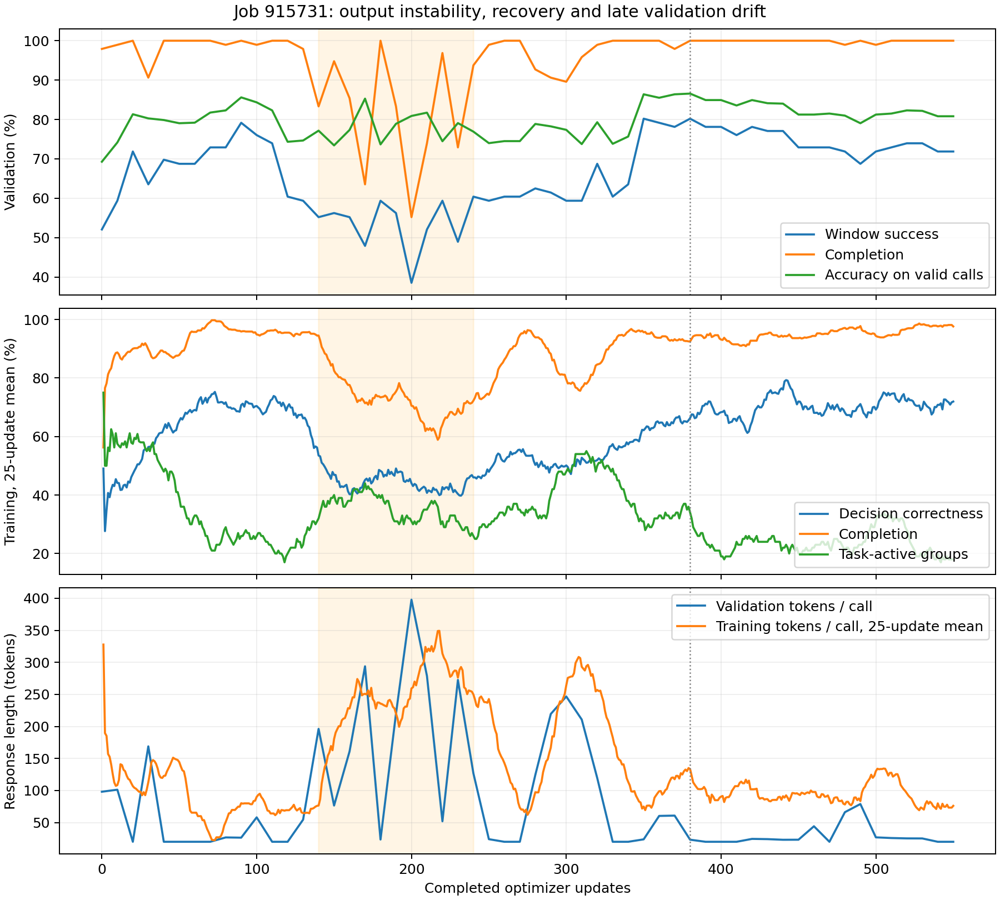

# Job 915731：完整训练曲线审核与调度修订

2026-10-08。检查的是原始 550 次更新、26,094 个训练调用，以及 **55 次训练后
validation + 1 次初始基线**，不是只比较 best/latest。训练在 3,500,783 response
tokens 暂停，6M 尚未完成。本次没有提交 GPU 任务。

进一步按题追踪全部22次曝光，见 [逐题信号历史](signal_history/README.md)：27题
永久无task advantage（14全0、7全1、6整组对错切换），其余73题至少一次active。
持续全错题后期全部固定于错误动作；信息题则常有后续reward却缺少首步正确探索。

证据来自 [原始运行归档](../terminal_hf_test_calbench_20261008/README.md) 中的
`raw/training-915731.tar.gz.part*`；已按 MANIFEST 校验并解包全部 1,727 个文件，
共 692,515,022 bytes。pool+selection SHA 与原 experiment 匹配。保留原始归档不改写。

- [完整验证点 CSV](validation.csv)：56 个验证点，包括 token 进度、完成率、合法调用正确率和非平坦 Q 正确率。
- [汇总及分层指标](summary.json)：阶段时间、题组对比度、k、入口类型与信息价值题表现。
- [逐 update 紧凑记录](training_updates.json)：550 个训练批次的采样指标。
- [曲线 PNG](trend.png) / [PDF](trend.pdf)：训练曲线为 25-update 滑动均值；验证为所有原始点。
- [复现脚本](analyze.py)：解包时校验 archive parts 与每个成员的 SHA256；仅使用已记录输出，不调用模型。



## 验证趋势

| 完成 updates | 训练 tokens | 整段成功率 | 完成率 | 逐步正确率，失败计 0 | 合法调用正确率 |
| --- | ---: | ---: | ---: | ---: | ---: |
| 0，base | 0 | 52.08% | 97.92% | 68.39% | 69.28% |
| 90，早期高点 | 395,127 | 79.17% | 100% | 85.62% | 85.62% |
| 140 | 563,217 | 55.21% | 83.33% | 68.53% | 77.17% |
| 200，最低点 | 1,258,476 | 38.54% | 55.21% | 54.55% | 80.90% |
| 350 | 2,567,172 | 80.21% | 100% | 86.39% | 86.39% |
| 380，保存的 best | 2,747,109 | 80.21% | 100% | 86.58% | 86.58% |
| 550，latest | 3,500,783 | 71.88% | 100% | 80.82% | 80.82% |

**前期提高，中期输出失稳，随后恢复，后期决策退化。**第 200 次验证的 132 个
slice calls 中有 28 truncated、15 invalid；平均输出 397.8 tokens/call。
第 380 次只有 23.3 tokens/call，550 次为 20.0，均无 slice 协议失败。
中期大量长解释在 1024 上限前未完成合法 act，导致整段指标急跌。
合法调用正确率也会受“哪些难题还成功输出、哪些后续节点被访问”影响，不能把
200 次的 80.90% 解读为战略能力保持不变：当时非平坦 Q 调用正确率仅 46.81%。

380→550 的验证下降并非格式失败：两者完成率都是 100%，非平坦 Q 正确率
从 81.65% 降到 73.58%。96 个固定实例里 9 个由成功变失败、1 个反向变化，
净少 8 个成功；proposal 入口 73.91%→65.22%，response 入口 86%→78%，
k=1/2/3 均下降。失去的 9 个成功分布在 5 个 parents。

## 训练采样趋势

下表按实际调用/轨迹加权；题目宏平均另用于核对题目组成变化。

| updates | 逐步正确率 | trajectory 完成率 | 截断 calls | tokens/call | 非零 task advantage 组 | 信息价值题整段成功 |
| --- | ---: | ---: | ---: | ---: | ---: | ---: |
| 1–100 | 66.36% | 93.22% | 4.35% | 87.6 | 36.50% | 6/384 |
| 101–140 | 62.26% | 94.84% | 3.33% | 70.8 | 27.50% | 0/120 |
| 141–240 | 46.52% | 70.31% | 19.97% | 259.3 | 34.25% | 1/432 |
| 241–340 | 54.61% | 88.41% | 7.37% | 167.1 | 41.50% | 0/352 |
| 341–400 | 67.58% | 93.07% | 4.65% | 106.7 | 27.92% | 0/248 |
| 401–550 | 72.12% | 95.71% | 2.85% | 94.1 | 23.17% | 2/576 |

100 道题各曝光恰好 22 组，不是 sampler 漏题。前 100 次与最后 150 次的题目
宏平均逐步正确率为 61.73% / 68.24%；proposal 和 response 入口的成功率也都
提高。训练上升不能只用 batch 题目变容易来解释。但这里 train temperature=1，
validation=0，reset/题目也不同，二者绝对数值不能直接作泛化差距比较。

## 为什么效果不稳定、信息学习尤其差

1. **小 batch 的任务信号稀疏，更新与同步成本却按次支付。**每次只 4 题。
   2,200 组中 699 组有非零 task advantage（31.77%）；865 组全部 reward=1，
   636 组全部=0。550 次更新中 125 次没有 task advantage，107 次连 protocol
   advantage 也为零，此时优化仍可受到 reference KL 作用。后 150 次的 task-active
   组只剩 23.17%。不应把这些更新全部计为有效战略学习。
2. **task-active 不等于同一决策有好坏动作对比。**只有 549/2,200 组的 trajectory
   平均 reward 在 replicas 间有差异。其余 150 个 task-active 组没有这种差异，
   非零局部 advantage 可以来自同一轨迹中“前一步错、后一步对”。特别是 12 道
   信息价值题：264 个组中 227 个 task-active，但 2,112 条轨迹仅 **17 次首步
   正确（0.805%）**，整段只有 **9 次成功（0.426%）**。后续较容易动作贡献
   大量 reward，汇总分掩盖了调查入口几乎学不会的事实。
3. **中期输出模式失稳是实测问题。**长解释/未完成 act 与失败同步上升；实际
   输出还反复把 prior weights 当作 utility weights、把 goal preferences 当作
   action preferences。样例说明存在规则理解错误，不能据此估计全量错误占比。
   现有局部 binary reward 将所有非最优动作都记 0，缺少错误之间的排序；
   token 平均 loss 也让长解释与短 act 的每-token 权重不同。这些是需要独立
   ablation 的候选原因，日志不能证明某个 loss 项或学习率单独导致失稳。
4. **后期呈现训练提升、固定验证退化。**选定 100 题反复训练、仅 12 个 validation
   parents、单 reset、temperature=0，容易产生有限分布适配和 greedy 决策切换。
   现象与过拟合/策略漂移一致，尚不能唯一归因。PPO clip_fraction 阶段均值约
   0.13%–0.25%，没有大面积 clipping 的证据；75 次 behavior-probability warnings
   也需要与数值后端诊断分开看，不能直接认定为失效更新。
5. **评测缺少信息价值题。**train 有 12 道 information-positive 题，validation/test
   均为 0；80.21% 的 best 并不证明学会调查与利用答案。独立 HF test 的 best/latest
   整段成功率 63.6875% / 63.1875%，parent-cluster CI 覆盖零，见原评测报告；
   当前没有同配置 base 的完整 test 曲线，不能把验证提升推广为所有 held-out 能力。

没有证据支持将问题归为 oracle 数值容差过紧：已有 Q 重算误差约 1e-15，远小于
1e-7。**“只奖励精确最优”的 binary 信号较稀疏**与**浮点误差误判**是两回事。
提高接受容差或重定 reward 会改变研究口径，本次调度修订未改这两个条件。

## 实际时间开销与已经落地的修订

phase 覆盖 20.10 小时；以下 validation 已扣除嵌套的 best checkpoint 时间，
不会重复计数。phase 外的权重同步/记录等不能全部归到某个已测阶段。

| 阶段 | 次数 | 独占时间 |
| --- | ---: | ---: |
| 训练 rollout | 550 | 6.24 h |
| 权重同步 | 550 | 4.51 h |
| validation，包括 base | 56 | 4.61 h |
| optimizer update | 550 | 1.99 h |
| checkpoint | 55 | 1.35 h |
| reference + actor log-prob forward | 550 各一次 | 0.84 h |

验证 + 保存 + 训练前同步合计占 phase wall time **52.08%**。验证额外生成
1,291,109 tokens（相当于训练输出量的 36.88%，不计入训练预算）。同一步 best
保存与周期保存已有 COMPLETE guard，实际不是重复写两份，而是每 10 updates
确实写了一次；仅保留两份目录不能免去前面 55 次写盘成本。

新训练合同 `terminal-step-binary-shared-reset-loo-fixed-questions-v4`：

- 默认 **20 题 × 8 trajectories = 160**，保持 32 并发、train microbatch=1；
  5 个 question waves 完成后、累积整个 collection 梯度，才做一次 optimizer
  update。100 题每 5 updates 覆盖一遍。同等题组曝光的更新/训练前同步次数降为
  原来的 1/5；不是减少每题采样数，也不保证实际训练总时长直接缩短 5 倍。
- 每 **500,000 训练 response tokens** 跨界 validation；初始基线和正常结束仍
  评估。6M 最多 12 次训练后验证，加 1 次基线；完整 batch 可能跨越多个阈值，
  只评估实际存在的更新后模型一次。
- 恢复 checkpoint 每 **1,000,000 tokens**，与验证解耦；best（含现有并列规则）、
  结束/暂停仍立即保存。保存后仍仅保留 best + latest/final，同步边界随 checkpoint
  恢复；COMPLETE guard 保持同一步去重。
- 显式 `--eval-every` / `--save-every` 仍可按 update 覆盖，用于 smoke，默认不开。
- 新增 root correctness、root reward contrast、information-positive root correctness
  日志，区分首步调查学习与后续步骤的得分。
- 数据、oracle、binary reward、epsilon、protocol penalty、LR token schedule、KL
  和最终 test selection 均延续现有定义。新合同和代码 hash 禁止旧 v3 checkpoint
  静默迁移；旧 job 915731 的 550 updates 与 best/latest 结果保留原身份。

这解决调度和小 batch 方面的已知问题。**信息题的正确动作探索不足和局部 reward
结构仍需后续受控实验**；不应仅把旧训练续到 6M 就期望它自动解决。下一轮应优先
记录相同决策处正确/错误动作对比，再讨论 Q-gap 分级反馈或正确动作探索的独立
ablation，并补充不污染现有 frozen test 的新 held-out 信息 families。

## 复现与检查

### 对 D 筛选与 20×8 依据的补充核对

699 是 2,200 个**题组曝光**中的非零 task advantage 组，不是 699 道独立题。
其余 1,501 组恰好由 865 个全部逐步 binary reward=1 和 636 个全部=0 的组组成；
全部=0 包含次优动作和协议失败，协议 penalty/KL 仍可能非零。每道题重复 22 组，
因此这些数不能直接解释为选集里多少道题永久无效。

当时 selected 100 的 D 中，58 题有同 prompt 首步 Q-gap 差异，只有 **44 题**
实际观察到首步“最优/次优”混合；77 题有任意一步 Q-gap 差异，88 题有
gap/completion 差异，12 题因信息对照保护而保留。Q-gap 差异不保证 binary
reward 差异：例如 max Q=1，采样两个动作 Q=.7/.8，gap 不同但 reward 均为 0。
此外 D 为独立 resets、temperature=.8、输出上限4096；训练为组内共享 reset、
temperature=1、上限1024，且策略在更新。因此此前筛选验证了诊断/覆盖价值，
没有验证每道题在当前训练合同下都具有稳定、足够的有效 advantage。

20×8 最初是工程候选：保持8 replicas和32并发，每次聚合5个原批次，减少同步/
更新次数；100题每5次更新覆盖一次。没有训练对照证明20最优。随后用原训练
units 按曝光顺序重分组，得到以下**离线诊断**：

| 每 batch 题组 | batch 数 | 全部 task advantage 为0的 batch | 平均 task-active 题组 |
| ---: | ---: | ---: | ---: |
| 4，原始 | 550 | 125 | 1.27 |
| 8 | 275 | 19 | 2.54 |
| 10 | 220 | 8 | 3.18 |
| 20 | 110 | 0 | 6.35 |
| 25 | 88 | 0 | 7.94 |

重分组使用旧策略轨迹，原批次之间发生过更新；它不等于新大 batch 在固定权重下
重新采样的实验，也不证明20优于10或25。扩大 batch 不改变全对/全错题组自身
的零 task advantage，也不提高缺失正确调查动作的采样概率；它只聚合更多题组。
故20保留为待 GPU/学习效果验证的候选默认，首步信号不足不能由此宣称已解决。

```bash
# 在仓库根目录，解包 selected-v4 数据后执行。
MPLCONFIGDIR=/tmp/marshal-matplotlib PYTHONPATH=. \
  python new/terminal_training_review_20261008/analyze.py \
  --extract /tmp/marshal-915731-review --output /tmp/marshal-915731-summary

python -m training.strategic_slices.train_terminal --check-only
python -m unittest training.strategic_slices.test_terminal_schedule \
  training.strategic_slices.test_terminal_training \
  training.strategic_slices.test_terminal_checkpoints \
  training.strategic_slices.test_terminal_final_test \
  training.social_mixed.test_training_contract
```

CPU 检查覆盖完整生产 loop 的 token hook、正常结束/提前暂停保存、20 题跨 waves
与跨 shuffle cycle 的采样/轨迹等价、trajectory 权重、精确 sampler resume，及
既有 best/final 生命周期，**30 项全部通过**。真实 v4 数据的 [CPU mock 验收](mock_check.json)
完成 20 题 / 160 trajectories / 242 controlled calls，重复下一批的恢复结果一致；
token IDs/logprobs 为合成数据，没有新模型调用。完整 `training.social_mixed.test_training` 在本机因缺少
Ray 无法导入，未安装依赖。本次新 160-trajectory batch 尚未做 GPU 显存与耗时
验收；旧 4 题 smoke 不能替代这项验收。
