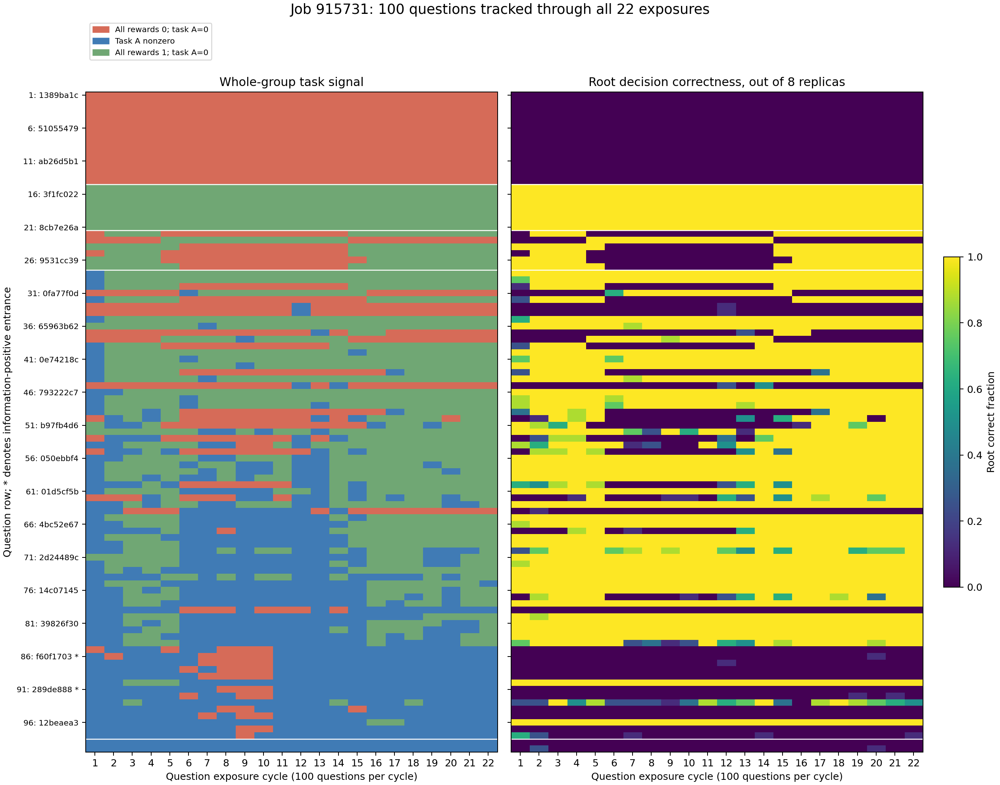

# 逐题追踪：无任务信号的题在变化吗？

2026-10-08，job 915731。按题对齐全部22次曝光，读取原始550批的units/calls/games，
共1,650个文件，逐文件校验原MANIFEST的SHA256。100题每轮各一组、每组8条。
总数与既有汇总严格匹配：699 active、865 all-correct、636 all-zero。
本次不重新采样、不运行模型、不重算oracle、不改训练协议。

## 无信号题有固定核心，也有大量变化

这里“信号”专指 **task advantage非零**；protocol penalty、KL另计。
`+`为题组中至少一个非零task advantage，`1`为所有实际调用的binary reward=1，
`0`为全部=0。后一类可以包含协议失败，不能一概当作合法战略错误。

| 22次曝光中的表现 | 题数 |
| --- | ---: |
| 始终全部=0，无task advantage | 14 |
| 始终全部=1，无task advantage | 7 |
| 每次组内同对/同错，但跨轮在全部=0/1之间切换，始终无task advantage | 6 |
| 有信号与无信号交替 | 71 |
| 每轮都有非零task advantage | 2 |

**27题永久无任务信号，73题至少出现过一次。**永久无信号题贡献594/1,501个
无信号题组（39.57%）；其余907组来自71道间歇性题目，不能将每轮无信号组当作
固定的一批坏题。最后5轮（第18–22轮）连续无信号的65题中，27题永久无信号，
38题此前有过信号；这38题的最后5轮为 **31题全对、7题全0**。

| 曝光轮次 | active | all-correct | all-zero |
| ---: | ---: | ---: | ---: |
| 1 | 58 | 14 | 28 |
| 5 | 22 | 51 | 27 |
| 9 | 33 | 22 | 45 |
| 13 | 49 | 21 | 30 |
| 18 | 20 | 58 | 22 |
| 22 | 18 | 60 | 22 |

## 无advantage不代表动作不变

永久无信号的27题中，15题在**相同root prompt**下采过不同合法动作。
这些题的root Q全部非平坦，不能解释为所有动作都一样好。

### 14道持续全错：固定错误与变化中的错误

14题均为k=1，共2,464条轨迹：2,431条合法但次优，仅33次协议失败。
因此长期全0主要是战略错误，不能用截断解释。

- **6道response**：所有合法样本始终选`action_index=1`，唯一最优动作是0。
  其中5题176/176条都是同一个错误动作；另1题175条同一个错误动作、1条截断。
  六题各自的root prompt在22轮间相同，root Q也一致。
- **8道proposal**：22轮内均出现过不同错误动作，但从未采到最优动作。
  其中7题采到的次优动作具有不同Q-gap；binary reward仍全部压成0。
  在这些永久全错proposal题中，18个题组在组内采到不同Q-gap，仍没有binary对比。
- **最后4轮，14题每道的32条轨迹都固定为同一个错误动作**，均合法。
  此处“固定”描述观察到的样本，不声称未采样动作的概率严格为0。

| 题目ID前缀 | 入口 | 22轮合法动作计数 | 最优动作 | 最后4轮 |
| --- | --- | --- | --- | --- |
| `1389ba1c` | response | 1:176 | 0 | 1:32 |
| `328076ce` | response | 1:175；另1次截断 | 0 | 1:32 |
| `328b5d8e` | proposal | 1:69，4:35，7:69；另3次失败 | 5 | 7:32 |
| `685b0936` | proposal | 1:64，4:33，7:71，8:3；另5次失败 | 2、5 | 7:32 |

`328b5d8e`的合法动作gap分别为2、0.5、2/3；这些动作优劣不同，但训练给它们
相同的0分。整个组都采到次优动作时，LOO baseline也为0，任务项无法区分它们。

原记录的native SamplingParams路径使用temperature=1、top_p=1、top_k=-1；
resolved config的do_sample=True。检查`1389ba1c`、`44077968`、`51055479`三个
response案例，每题176个不同request seeds，输出token序列却完全相同。
动作数字token在已生成工具调用前缀条件下的记录概率极高；例如`1389ba1c`
前4轮平均约99.996%，最后4轮记录为1。它只是这个前缀下的token概率，不是对
所有response路径的完整动作概率；浮点表示也可能将近1舍入到1。
因此不同seed/temperature=1并不保证有足够动作探索，当前检查没有发现重复seed。

### 6道持续零advantage，却整组由错变对、再变错

六题均为k=1 proposal，22轮中root prompt和实际抽到的world各自不变，调用全部合法。
例子`18ff2f01`的历史是：

```text
曝光轮次： 1–4       5–14        15–22
组内结果：全部错     全部对      全部错
任务A：   全部0      全部0       全部0
```

它早晚主要选7/8，中期选1；最优集合为1/4。该题自身没有任务梯度，却仍可受
其他题的梯度、KL及共享参数更新影响。不能将零advantage解读成模型参数不变，
也不能认为这种变化获得了针对该题的直接纠错反馈；日志未分离各项的因果贡献。

## D筛选的差异现在可以具体定位

27道永久无信号题中，**18题在D中曾有首步Q差异，14题甚至曾采到首步
最优/次优混合**。14道持续全错题里，8题在D中曾采到这种混合，含全部6道
固定错误response题。它们不能解释为游戏没有决策价值或D从未采到正确动作。
D中已有的动作对比在当前native训练采样中未重现。

这证明D筛选与训练有效信号之间的错位，但尚未定位全部原因。两者的输入
渲染/工具模板、generation路径、输出预算、策略与采样设置需要逐项核对。
尤其六道response从第一次曝光就全错，不能仅归因于后期训练过拟合。

## 信息题：整段active很多，首步信号却很少

12道information-positive题全部至少有17轮active，累计227/264组；它们没有
落在永久无信号27题内。但 **7道题在全部176条轨迹里从未选对首步**，
另外5题也很稀少：首步正确合计17次，仅11个题组观察到首步binary对比。

整段有非零任务advantage不保证调查入口获得了好坏动作比较。不少active来自
后续正确动作与前面错误动作的局部奖励差别，应与首步探索分开统计。

## 完整数据与复现



左图红/绿均为零task advantage，蓝色为非零；右图为8条轨迹的首步正确比例。
同一题目顺序：前14行永久全0，随后7行永久全1、6行零A但切换，再后71行
间歇性、最后2行始终active。信息题可出现左图长期蓝色、右图长期零。

- [逐题CSV](questions.csv)：100题的22字符历史与D/训练对照。
- [逐题逐轮JSON](questions.json)：2,200个组的动作、Q-gap、失败、world、prompt证据。
- [汇总JSON](summary.json)：轮次变化、分类、状态转移与信息题细节。
- [PDF](history.pdf) / [图表行号映射](heatmap_row_order.json)。
- [分析脚本](../analyze_signal_history.py)。

```bash
# 先按上级README解包原训练archive；使用已解包selected-v4数据。
MPLCONFIGDIR=/tmp/marshal-matplotlib PYTHONPATH=. \
  python new/terminal_training_review_20261008/analyze_signal_history.py \
  --run /tmp/marshal-training-review-20261008/terminal-train-qwen3-4b-instruct-single96-full-20261006
```

当前同时存在已饱和题、持续采不到最优动作的题、因共享模型变化而整组切换却
得不到自身任务反馈的题，以及首步失败被后续reward掩盖的题。只看总active比例、
统一增加曝光或扩大batch，都不能区分和解决这些情况。
